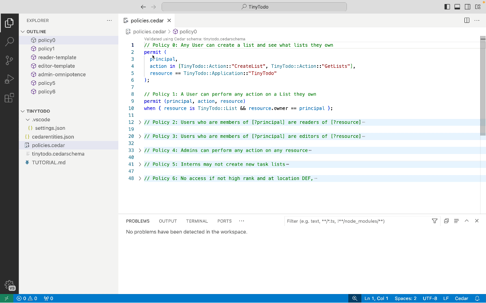
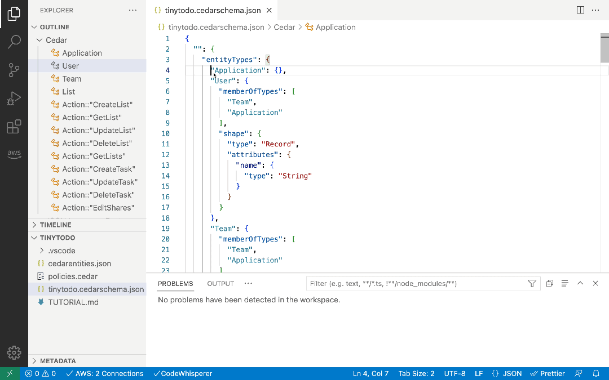
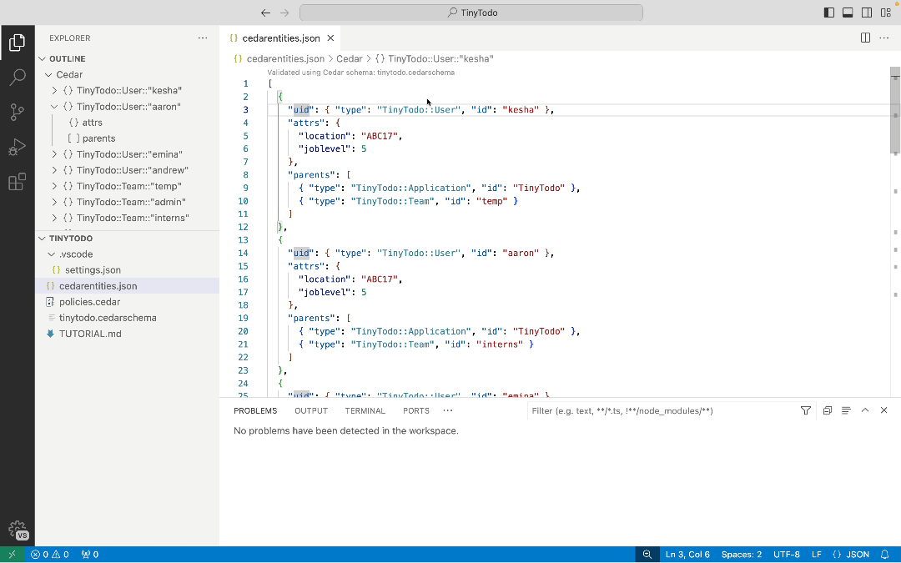
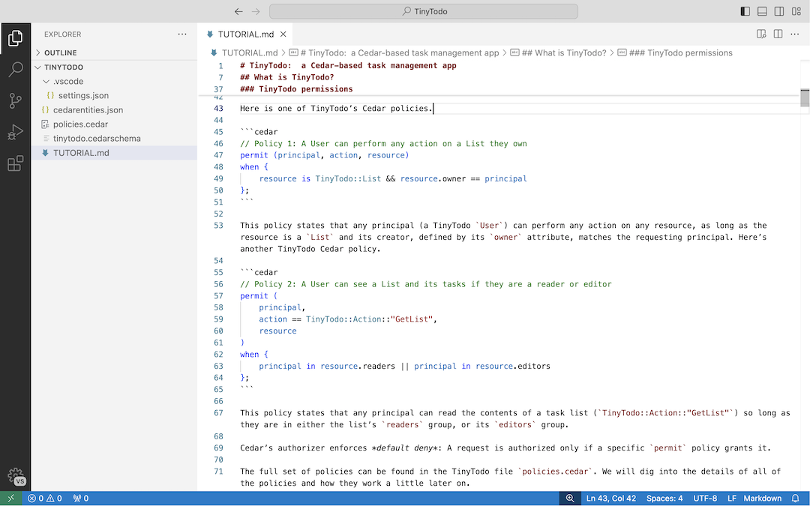
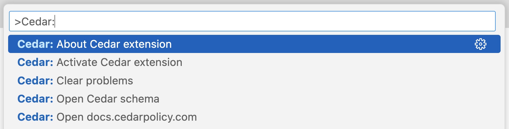

# Cedar policy language for Visual Studio Code

The Cedar policy language extension for Visual Studio Code supports syntax highlighting, formatting, and validation.  Install from the [Visual Studio Marketplace](https://marketplace.visualstudio.com/items?itemName=cedar-policy.vscode-cedar) or by [searching within VS Code](https://code.visualstudio.com/docs/editor/extension-gallery#_search-for-an-extension).

Cedar is an open-source language for writing authorization policies and making authorization decisions based on those policies. Visit the [Cedar policy language reference guide](https://docs.cedarpolicy.com/) for the documentation and the language specification.

**Note:** The release version of this extension uses Cedar SDK 4.x.

## Features

### Cedar policy language

Files matching `*.cedar` are detected as a Cedar policy language and receive syntax highlighting.  Validation is performed on document open, document save, during formatting, and via context menu.  IntelliSense for entity types and attributes.  Formatting can disabled per file using a leading comment line of `// @formatter:off`.  Policy navigation using Outline or Breadcrumb.  "Go to Definition" on Cedar entity types and action names.  Policies are exportable to their JSON representation (`*.cedar.json`) and receive syntax highlighting.



### Cedar schema

Files named `cedarschema` or matching `*.cedarschema` are detected as a Cedar schema and receive additional syntax highlighting.  Validation is performed on document open, document save, and via context menu.  When a Cedar schema file is detected or configured in [Settings](#settings), additional validation of Cedar files uses that schema.  Entity type navigation using Outline or Breadcrumb.  "Go to Definition" on Cedar entity types and action names.  The Cedar schema JSON format is supported for files named `cedarschema.json` or matching `*.cedarschema.json`.



### Cedar entities

Files named `cedarentities.json` or matching `*.cedarentities.json` are detected as Cedar entities and receive additional syntax highlighting.  Validation is performed against a Cedar schema on document open, document save, and via context menu.  IntelliSense for entity types and add entity via context menu.  Entity navigation using Outline or Breadcrumb.  "Go to Definition" on Cedar entity types.



### Cedar tests

Files named `cedartests.json` or matching `*.cedartests.json` are detected as Cedar tests and receive additional syntax highlighting.  Validation is performed against a Cedar schema on document open, document save, and via context menu.  IntelliSense for tests and embedded entities, and add test via context menu.  Test navigation using Outline or Breadcrumb.  "Go to Definition" on Cedar entity types, action names, and `reason` policy ids.  Tests are run using the Visual Studio Code [Testing](https://code.visualstudio.com/docs/editor/testing) view, evaluated against the Cedar policy (`*.cedar`), template links (`cedartemplatelinks.json`), entities (`cedarentities.json`), and schema files alongside the tests file.

### Cedar CLI

Various commands of the `cedar` CLI take JSON formatted file inputs.  Files named `cedarauth.json` or matching `*.cedarauth.json` are detected as input to the `--request-json` option for the `authorize` command.  Files named `cedartemplatelinks.json` or matching `*.cedartemplatelinks.json` are detected as input to the `--template-linked` option for the `authorize` command.  These files receive additional syntax highlighting.

The `cedar` CLI is optional and detected on the `PATH` during startup, and its version is reported by the "About Cedar extension" command.  When detected, context menu and Command Palette commands run `validate`, `run-tests`, `check-parse`, and `authorize` on the current file in a reused **Cedar CLI** terminal, using the Cedar schema, policy, template links, and entities files detected alongside it.

### Markdown

Syntax highlighting of `cedar` and `cedarschema` code fence blocks within markdown (`*.md`) files.



### Command Palette

To see all available Cedar commands, open the [Command Palette](https://code.visualstudio.com/docs/getstarted/userinterface#_command-palette) and type **Cedar**.



### Settings

Sample `.vscode/settings.json` which enables `editor` settings for `cedar` files, sets a workspace level Cedar schema, and enables auto detection of folder level Cedar schema files.

```json
{
  "[cedar]": {
    "editor.tabSize": 2,
    "editor.wordWrapColumn": 80,
    "editor.formatOnSave": true,
    "editor.defaultFormatter": "cedar-policy.vscode-cedar",
  },
  "cedar.schemaFile": "tinytodo.cedarschema",
  "cedar.autodetectSchemaFile": true,
}
```

### Cedar schema sets

A Cedar policy, entities, or tests file validates using the Cedar schema files in its folder, else those in the workspace folder, else the `cedar.schemaFile` setting.  When there is more than one schema file, they are combined into one schema:

- **Linked**, when any of them declares an `external` entity type or action (`external entity User;` or `"external": true`).  Each schema file stands on its own, and each `external` declaration is resolved against a definition of the same name in another schema file (see [schema linking](https://docs.cedarpolicy.com/schema/schema-linking.html)).
- **Merged**, otherwise, as fragments of one schema, so a schema file can refer to the entity and common types of another without declaring them.

A schema with an `external` declaration that no schema file defines is partial: entities still validate, but policies can't be validated until every `external` declaration has a definition.  Hover over or go to definition of an `external` declaration (or a type another schema file defines) to see its definition.  Problems combining the schema files are reported on the schema file each problem is in, and the "Validated using" CodeLens opens any of the schema files or the combined schema (JSON).  A folder of unrelated schema files, with no `external` declarations and nothing alongside them to validate, is not combined.  See the `testdata/schemaset-*` folders for examples.

`cedar.schemaFile` is either one schema file, or an array of schema files and glob patterns combined into one schema, relative to the first workspace folder:

```json
{
  "cedar.schemaFile": ["shared/identity.cedarschema", "app/*.cedarschema"],
}
```

### Level validation

When `.cedar` files validate using a Cedar schema, the minimum entity dereference level each policy validates at (see [level validation](https://docs.cedarpolicy.com/policies/level-validation.html)) is shown, depending on `cedar.levelValidation.display`, as a CodeLens above the policy (`codeLens`), an inlay hint comment like `// Level 2` after the policy's `;` (`inlayHint`), or not at all (`none`).  Set `cedar.levelValidation.maxLevel` to warn on any policy which requires a higher level.

```json
{
  "cedar.levelValidation.maxLevel": 2,
  "cedar.levelValidation.display": "codeLens",
}
```

### File associations

JSON files are detected as Cedar files by the `cedar*.json` naming convention described above.  `cedar.fileAssociations` maps glob patterns to a Cedar file kind for files which don't follow that convention, in the style of [`files.associations`](https://code.visualstudio.com/docs/languages/overview#_add-a-file-extension-to-a-language).  A pattern without a `/` matches that filename in any folder.  The built-in names take precedence, then associations are matched in order.  Supported kinds are `cedarschema.json`, `cedarentities`, `avpentities`, `cedartemplatelinks`, `cedarauth`, `cedartests`, and `cedar.json`.

```json
{
  "cedar.fileAssociations": {
    "schema.json": "cedarschema.json",
    "entities.json": "cedarentities",
    "tests.json": "cedartests",
    "links.json": "cedartemplatelinks"
  }
}
```

Associated files receive the same syntax highlighting, validation, navigation, and IntelliSense as the conventionally named files, and are used when locating the Cedar files a tests file is evaluated against.  An associated Cedar schema is found by `cedar.autodetectSchemaFile`, so `cedar.schemaFile` is not needed to point at it.  Since this setting is folder scoped, it can be set per folder of a multi-root workspace.

Cedar schema files using the Cedar syntax don't need this setting, since `cedarschema` is a language and can be associated using `files.associations`.

```json
{
  "files.associations": {
    "schema.txt": "cedarschema"
  }
}
```

## Troubleshooting

Submit bug reports and feature requests [on our GitHub repository](https://github.com/cedar-policy/vscode-cedar/issues). For potential security issues, visit [reporting a vulnerability](https://github.com/cedar-policy/vscode-cedar/security/policy) for instructions.
